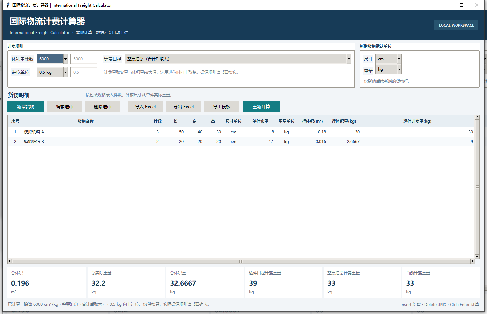

# International Freight Calculator

International Freight Calculator 0.3.0 是一款离线运行的中文桌面工具，用于整理多件货物的体积、实际重量、体积重和计费重量。它不连接承运商报价系统，也不代表任何承运商的通用计费规则。



## 功能

- 多行货物与每行多件包装。分别展示行体积、行实际重量、行体积重及逐件口径计费重量。
- 支持 cm/in 与 kg/lb，计算时换算为 cm 和 kg。
- 体积重除数支持 5000、6000 和自定义值。
- 并列计算逐件口径与整票汇总口径，可选不进位、0.1、0.5、1 kg 或自定义增量向上进位。
- 导入、导出 `.xlsx`，并提供带单元格校验、填写说明和计算参数的空白模板。
- 所有计算和货物输入均在本机完成。程序不会自动联网或上传数据。

## 快速计算示例

以下货物和规则均为合成示例，不代表承运商实际计费条件。设体积重除数为 `6000 cm³/kg`，采用整票汇总、`0.5 kg` 向上进位：

| 规格 | 件数 | 单件尺寸 | 单件实重 | 行体积 | 行实重 | 行体积重 |
| --- | ---: | --- | ---: | ---: | ---: | ---: |
| 模拟纸箱 A | 3 | 50 × 40 × 30 cm | 8 kg | 0.18 m³ | 24 kg | 30 kg |
| 模拟纸箱 B | 2 | 20 × 20 × 20 cm | 4.1 kg | 0.016 m³ | 8.2 kg | 2.6667 kg |

汇总：总体积 **0.196 m³**，总实重 **32.2 kg**，总体积重 **32.6667 kg**；整票汇总口径取较大值后向上进位为 **33 kg**。逐件口径则为 **39 kg**。该差异用于说明“逐件取大再进位”与“整票合计后进位”的算法不同，实际渠道规则须单独核实。

## Windows 运行

普通 Python 运行需要 Python 3.11 或更新版本，且安装包含 Tkinter。项目运行依赖只有 `openpyxl`。

```powershell
py -3.12 -m venv .venv
.\.venv\Scripts\python.exe -m pip install -r requirements.txt
.\.venv\Scripts\python.exe -m freight_calculator
```

也可以安装为当前 Python 环境的命令：

```powershell
py -3.12 -m pip install -e .
freight-calculator
```

如本机没有 `py` 启动器，请将命令中的 `py -3.12` 改为 Python 安装目录下的 `python` 可执行文件。逐步操作说明见 [用户指南](docs/USER_GUIDE.md)。

## 便携 EXE

Windows 单文件构建脚本会在项目内创建隔离的 `.venv-build`，然后输出 `dist\FreightCalculator.exe`。运行该 EXE 的普通用户不需要单独安装 Python。

```powershell
.\build_windows.ps1
```

脚本默认使用 `py -3.12`，没有启动器时使用 `python`。也可指定 Python 3.11+ 的可执行文件：

```powershell
.\build_windows.ps1 -PythonExe "C:\Path\To\python.exe"
```

单文件 EXE 尚未数字签名，也不是安装程序。首次运行可能受 Windows SmartScreen 或安全软件提示。该构建依赖 PyInstaller，首次构建需从 PyPI 安装构建依赖。完整步骤和限制见 [Windows 构建说明](docs/BUILD_WINDOWS.md)。

## 计算规则

体积重（kg）= 长（cm）×宽（cm）×高（cm）÷体积重除数。体积（m³）= 长×宽×高÷1,000,000。英寸按 1 in = 2.54 cm 换算，磅按 1 lb = 0.45359237 kg 换算。

- **逐件计算**：每件取实际重量与体积重中的较大值，按设置的进位单位向上进位，再乘件数并汇总。
- **整票汇总**：先汇总整票实际重量和体积重，取较大值，再按设置的进位单位向上进位。

除数、计费口径和进位均为用户可调的计算参数，不是行业统一标准。实际计费还可能涉及最低计费、计泡/分泡、尺寸限制、额外操作费和其他渠道条件。使用前应向对应承运渠道核实书面规则。工具不判断货物可运输性，不提供运价、时效、清关或税费承诺。

## Excel 文件

只支持 `.xlsx`，不支持 `.xls`、`.xlsm` 或外部数据连接。导入至少需要一个名为“货物明细”的工作表，且包含以下列。表头可以重新排序，单位可以使用模板提供的缩写或中文别名。

`货物名称、件数、长、宽、高、尺寸单位、单件实际重量、重量单位`

可选“计算参数”页可恢复除数、计费口径和进位设置。导入使用普通单元格值，不执行公式或宏。文件最大 25 MB，最多 5,000 行货物资料；单项尺寸、重量和件数分别执行输入上限校验。导出结果中的计算值是静态快照，不会随上游费率或外部数据联动。

## 测试

```powershell
py -3.12 -m unittest discover -s tests -v
```

测试覆盖计算、单位换算、不同计费口径与进位、异常输入、Excel 模板验证、导入错误、公式样式文本安全、结果导出与往返一致性，以及可用时的 Tkinter UI smoke test。更多说明见 [测试指南](docs/TESTING.md)。

## 依赖

- 运行：Python 3.11+、Tkinter、`openpyxl>=3.1,<4`
- 打包：`pyinstaller==6.22.3`（仅构建 EXE 使用）

详见 [requirements.txt](requirements.txt) 和 [requirements-build.txt](requirements-build.txt)。

## 隐私与项目边界

应用不会自动联网。货物数据只在运行期间保存在内存中；仅在用户主动导入或导出时读取或写入所选 Excel 文件。仓库使用通用合成示例，不包含真实客户、供应商报价或运单数据。

## 参与贡献

欢迎提交可复现的问题报告和功能建议。请勿在 Issue、截图或示例文件中提交客户身份、真实货物单、运单、供应商价格、账号凭据或其他敏感资料。代码改动请附自动化测试，并遵循 [贡献指南](CONTRIBUTING.md)。

## 许可证与公开发布

本项目代码按 [MIT License](LICENSE) 授权；第三方运行和构建依赖仍按各自许可证授权。公开发布前应由项目权利人确认版权归属及许可证文本，并完成 [发布前检查清单](docs/RELEASE_CHECKLIST.md)。
